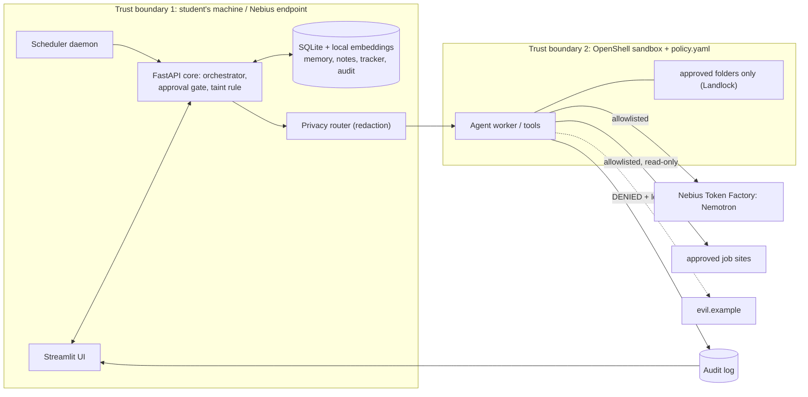

# Architecture and trust boundaries

Untrusted content (job postings) enters only as `<untrusted_data>`; the model proposes JSON actions, the core
executes them via `tools.call` (enabled -> taint rule -> fs/net policy -> approval -> execute -> audit).
In this repo the app-layer engine runs in-process; the OpenShell sandbox is exercised by `sandbox/sandbox_demo.py`.
Moving the real worker fully inside the sandbox is Person B's hour 8-12 task.
